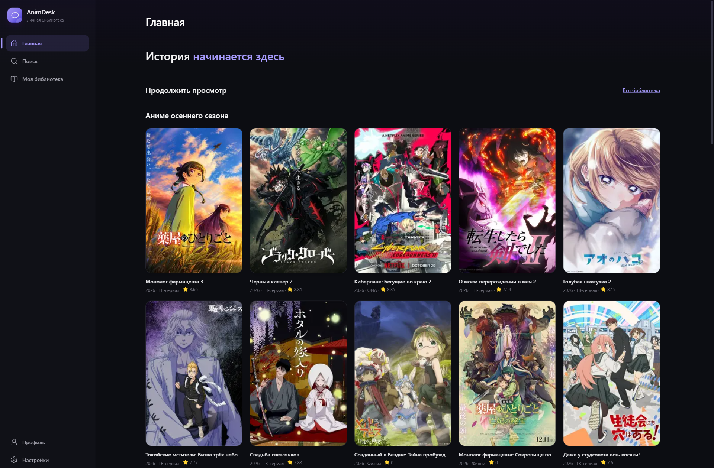

# AnimDesk 1.0

**[Скачать AnimDesk для Windows — GitHub Releases](https://github.com/dik001/AnimDesk/releases/latest)**

Локальная библиотека аниме для Windows 10/11: поиск метаданных Shikimori, карточки отдельных сезонов, пять статусов, ручной прогресс, заметки, личные оценки 1–10, профиль и статистика. Регистрация не требуется. Видео, озвучки и скачивание серий в эту версию не входят.

## Скриншот



## Зачем нужен AnimDesk

**Главная цель проекта — независимый доступ к аниме.**

Нет интернета — пожалуйста. Сайты с аниме заблокировали или привычный сервис перестал работать — у пользователя всё равно должна оставаться возможность открыть свою коллекцию и смотреть видео, уже доступное на его устройстве.

AnimDesk развивается в сторону **offline-first**: личная библиотека и пользовательские данные хранятся локально, а воспроизведение доступного на компьютере контента не должно зависеть от регистрации, облачного аккаунта или постоянной доступности конкретного сайта. Онлайн-каталог может помогать искать информацию об аниме, но не должен быть единственной точкой доступа к уже сохранённым видео.

### Куда развивается проект

- **Сначала локальный доступ:** библиотека, прогресс и сохранённая информация должны открываться без интернета.
- **Просмотр без обязательной сети:** цель будущего развития — воспроизведение локально доступных видео и работа с дорожками озвучки/субтитров без зависимости от сайта.
- **Меньше внешних зависимостей:** недоступность одного каталога или сервиса не должна лишать пользователя доступа к собственной локальной коллекции.
- **Контроль у пользователя:** данные и медиатека не должны требовать обязательного облачного аккаунта.

> **Важно о текущей версии:** эти пункты описывают направление развития, а не уже реализованные функции. В AnimDesk 1.0 пока нет видеоплеера, выбора озвучек или скачивания серий.

## Запуск и проверки

Нужны Node.js 24 LTS, npm, Rust MSVC, Microsoft C++ Build Tools с Windows SDK и WebView2 Runtime.

```powershell
npm ci
npm run tauri dev
```

Проверки: `npm run lint`, `npm run typecheck`, `npm test`, `npm run build`, `cargo check --manifest-path src-tauri/Cargo.toml --locked`, `cargo test --manifest-path src-tauri/Cargo.toml --locked`.

`npm run test:e2e` проверяет интерфейс в установленном Edge с тестовым SQLite/IPC-адаптером. Это не нативные Windows-диалоги. `npm run tauri build` собирает приложение и NSIS-инсталлятор; `npm run dev` позволяет посмотреть интерфейс в браузере, где постоянное хранение и нативные операции недоступны.

## Где лежат данные

Все пользовательские данные принадлежат этому компьютеру. Официальный Tauri SQL plugin хранит SQLite в `%APPDATA%\app.anidesk.desktop\anidesk.db`, вне каталога установки. Полный путь виден в настройках. Внешний API получает только запросы метаданных и не хранит профиль, библиотеку, заметки или оценки.

В каталоге данных приложения `%APPDATA%\app.anidesk.desktop` находятся:

- `cache\covers\<SHA-256 URL>.img` — кеш обложек аниме, добавленных в библиотеку. Путь из импортируемого JSON для чтения файлов не используется.
- `avatars\<SHA-256 содержимого>.img` — выбранный аватар. В SQLite записывается только относительный путь.
- `backups\before-replace-<дата UTC>.json` — защитные экспорты перед заменой библиотеки. Они остаются на диске, включая случай неудачного импорта после создания копии.

Обложки и аватар: PNG/JPEG/WebP, до 5 МБ, до 4096×4096, с проверкой декодирования и лимитом памяти. Обложки скачиваются только по HTTPS с точного списка доменов Shikimori/MAL, без перехода по редиректам, с таймаутом 8 секунд и ограничением параллельности. Относительные Shikimori URL нормализуются; относительные URL прежних импортированных записей нормализуются адаптером к `cdn.myanimelist.net`. Файлы отображаются как проверенные image data URL через узкий Rust IPC: WebView не получает файловых разрешений, путей чтения или asset scope.

## Как перенести библиотеку на другой ПК

1. В **Настройках** нажмите **«Экспортировать библиотеку»** и выберите JSON-файл в Windows-диалоге сохранения.
2. Перенесите файл на другой компьютер и установите AnimDesk.
3. Откройте **«Импортировать библиотеку»**, выберите JSON и проверьте количество аниме, записей и оценок в предпросмотре.
4. Выберите **«Объединить»** или **«Заменить библиотеку»**, поставьте подтверждение и примените импорт.

Новые экспорты используют `format: "animdesk-library"`, `schemaVersion: 1`, `exportedAt`, `profile.name`, `anime`, `library_entries` и `ratings`. Импорт также принимает корректные файлы предыдущего формата версии 1. Он содержит внутренние исходные ID, `provider`/`provider_id`, независимые `shikimori_id`/`mal_id`, метаданные, альтернативные названия, жанры, статусы, прогресс, заметки, даты и личные оценки. Оценённые аниме переносятся и в том случае, если ещё не добавлены в список. ID SQLite на новом компьютере могут измениться; все связи восстанавливаются по таблице соответствий.

Объединение сопоставляет записи только по достоверным внешним ID и точной исходной паре. Название не используется для склеивания сезонов. Противоречащие друг другу идентификаторы вызывают явную ошибку. При совпадении импортированные статус, прогресс, заметки и даты заменяют прежние; оценки из файла обновляются, отсутствующие в нём оценки сохраняются. Имя профиля берётся из файла. Перед заменой всех записей и оценок создаётся защитный JSON; невозможность создать пригодную к восстановлению копию отменяет замену. Исходный файл полностью проверяется до изменений, весь пакет применяется одной SQLite-транзакцией, ошибка откатывает пакет целиком. Максимум файла — 20 МБ и 10 000 аниме. Неподдерживаемая версия, дубли ID, неверные ссылки, значения или даты отклоняются.

Аватар, тема и кеш изображений не входят в переносимый JSON и не являются обязательными для восстановления библиотеки. На новом компьютере аватар можно выбрать заново, а обложки будут кешироваться при доступной сети. Для восстановления защитного экспорта выберите его обычным импортом.

## Без сети

После перезапуска доступны сохранённая библиотека, поиск по ней, детали сохранённых аниме, профиль, статистика и настройки. Сохранённые обложки и аватар читаются локально. Если обложка ещё не кешировалась, была удалена или не прошла проверку, показывается встроенная заглушка; её наличие офлайн не обещается. Внешний поиск и обновление метаданных требуют сети и показывают явное сообщение при её отсутствии. Если Windows считает соединение активным, но API не отвечает, действуют ограниченные ожидания и локальная карточка показывается до ответа сети.

Источник метаданных — Shikimori GraphQL.

## Структура

`src/app`, `src/pages`, `src/components`, `src/features`, `src/services`, `src/repositories`, `src/database`, `src/types` — интерфейс и данные. `src-tauri` — приложение, миграции, ограниченные команды изображений и атомарного импорта. Hash-router позволяет открывать маршруты в собранном WebView без сервера.

Требования: [PRODUCT_SPEC](docs/PRODUCT_SPEC.md). Выполненные проверки и ограничения: [PROGRESS](docs/PROGRESS.md).

## Архитектура

React и строгий TypeScript отвечают за интерфейс и репозитории. Tauri 2 и Rust выполняют ограниченные сетевые и файловые операции; официальный SQL plugin открывает SQLite. Миграции лежат в `src-tauri/migrations`. Shikimori GraphQL предоставляет метаданные, локальные пользовательские данные внешним API не передаются. Подробности каталога: [CATALOG](docs/CATALOG.md).

Название окна, пакета и исполняемого файла — AnimDesk (`animdesk.exe`). Для доступа к существующим данным сохранены стабильные ключи хранения; [контракт совместимости](docs/STORAGE_COMPATIBILITY.md). При обновлении используется прежняя база вместе с профилем, темой, кешем и аватаром.


## Установка AnimDesk

Системные требования: Windows 10/11 x64 и Microsoft Edge WebView2 Runtime. Запустите `AnimDesk_1.0.0_x64-setup.exe`; установщик NSIS устанавливает приложение для текущего пользователя. Если WebView2 отсутствует, его установка требует сети. Исполняемый файл — `animdesk.exe`. Данные находятся вне папки установки; перед обновлением рекомендуется экспортировать библиотеку.

## Окружение разработки

1. Установите [Node.js 24 LTS](https://nodejs.org/) с npm.
2. Установите [Microsoft C++ Build Tools](https://visualstudio.microsoft.com/visual-cpp-build-tools/) с нагрузкой «Разработка классических приложений на C++» и Windows SDK.
3. Через [rustup](https://rustup.rs/) установите Rust MSVC x64: `rustup default stable-x86_64-pc-windows-msvc`. Минимум Rust 1.90; локальная проверка выполнена с 1.94.0.
4. Установите [WebView2 Runtime](https://developer.microsoft.com/microsoft-edge/webview2/).
5. Выполните `npm ci`. Зафиксированные `package-lock.json` и `src-tauri/Cargo.lock` должны сохраняться.

Проект использует npm, Vite, Tailwind CSS, React Router и lucide-react. Массовое обновление библиотек для сборки не требуется.

## Релизная сборка Windows x64

Из корня проекта в PowerShell:

```powershell
npm run typecheck
npm run lint
npm test
npm run test:e2e
npm run build
cargo check --manifest-path src-tauri/Cargo.toml --locked
cargo test --manifest-path src-tauri/Cargo.toml --locked
cargo fmt --manifest-path src-tauri/Cargo.toml -- --check
npm run tauri build -- --target x86_64-pc-windows-msvc --bundles nsis
```

При явном `--target` результат находится в `src-tauri/target/x86_64-pc-windows-msvc/release/bundle/nsis/`. На Windows x64 команда `npm run tauri build` создаёт `src-tauri/target/release/bundle/nsis/AnimDesk_1.0.0_x64-setup.exe`. Frontend `dist` сам по себе не является приложением Windows. Установщик пока не подписан цифровым сертификатом.

Workflow `.github/workflows/windows.yml` проверяет код и собирает NSIS на Windows x64. При отправке тега `v*` после успешных проверок он публикует установщик в GitHub Releases. Версия тега должна совпадать с версией приложения. Ветки и pull request проходят те же проверки без публикации релиза.

## Каталог и ограничения запросов

Единственный онлайн-каталог — `POST https://shikimori.io/api/graphql`. User-Agent — `AnimDesk/1.0`; запросы выполняет Rust, регистрация пользователя не требуется. Локальный лимит: минимум секунда между запросами, не более 45 запросов за скользящие 60 секунд, включая повторы. HTTP 429 учитывает `Retry-After`; сетевые ошибки и 5xx допускают не более двух попыток. Сетевой запрос ограничен 5 секундами, вся операция с очередью — 12 секундами, IPC — 14 секундами. Сбой показывает ошибку с возможностью повторить, без другого онлайн-источника.

24 октября 2026 проверены оба домена Shikimori: `.one` завершился таймаутом, `.io` вернул HTTP 200 с реальной «Тетрадью смерти». Приложение использует `.io` как рабочий адрес того же каталога Shikimori, без альтернативного сервиса. Актуальные опубликованные требования к квотам не удалось повторно получить с сайта; локальные ограничения остаются консервативными.

## SQLite и совместимость

Миграции 001–004 создают таблицы аниме, названий, жанров, библиотеки, единственного профиля `local-default`, настроек и локальных оценок. Каждая запись имеет внутренний `anime.id`, исходную пару `provider + provider_id`, независимые nullable `shikimori_id` и `mal_id`. Старый `provider: jikan` сохраняется как идентичность данных, без сетевой интеграции. Для обновления такой карточки нужен достоверный Shikimori ID; иначе открывается сохранённая версия.

Старые JSON `format: "anidesk-library"` принимаются вместе с новым `animdesk-library`. Ключи хранения `app.anidesk.desktop`, `anidesk.db` и прежний ключ темы намеренно сохранены: переименование продукта не переносит и не обнуляет данные.

